# dos-bcdemos

Retro programming in Borland C++ 3.1

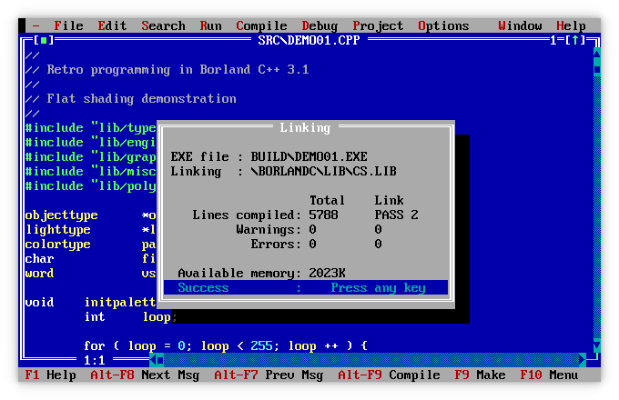

## Prerequisites

To build and run the Borland C++ demos, you must first install the following tools:

- [DOSBox Staging](https://www.dosbox-staging.org/)
- [Borland C++](https://winworldpc.com/product/borland-c/30)

### Install DOSBox Staging

#### Ubuntu

```
$ sudo add-apt-repository ppa:feignint/dosbox-staging
$ sudo apt update
$ sudo apt install dosbox-staging 7zip
```

#### macOS

```
$ brew install dosbox-staging sevenzip
```

#### Configuration

When starting `dosbox-staging` the first time, the configuration file `dosbox-staging.conf` will be generated in

- Ubuntu: `~/.config/dosbox/dosbox-staging.conf`
- macOS: `~/Library/Preferences/DOSBox/dosbox-staging.conf`

### Install Borland C++

1. Download [Borland CPP 3.1 and Application Frameworks (1992) (3.5-1.44mb).7z](https://dl.winworldpc.com/Borland%20CPP%203.1%20and%20Application%20Frameworks%20(1992)%20(3.5-1.44mb).7z)
   ```
   $ curl -o "Borland CPP 3.1 and Application Frameworks (1992) (3.5-1.44mb).7z" "https://dl.winworldpc.com/Borland%20CPP%203.1%20and%20Application%20Frameworks%20(1992)%20(3.5-1.44mb).7z"
   ```

1. Extract the downloaded Borland C++ archive
   ```
   $ 7zz x "Borland CPP 3.1 and Application Frameworks (1992) (3.5-1.44mb).7z"
   ```

1. Extract the Borland C++ disk images
   ```
   $ cd "Borland CPP 3.1 and Application Frameworks (1992) (3.5-1.44mb)"/
   $ for i in *.img; do echo $i; 7zz x -y -obcsetup $i; done
   ```

1. Move the extracted files to the DOS C: drive
   ```
   $ mkdir -p ~/DOSBox
   $ mv bcsetup ~/DOSBox/
   ```

1. Configure DOSBox Staging

   Edit `dosbox-staging.conf` (see [Configuration](#configuration)) and add the following autoexec options
   ```
   [autoexec]
   mount c ~/DOSBox
   path %PATH%;C:\BORLANDC\BIN
   c:
   ```

   In the `[cpu]` section, set the CPU speed to `25000`, roughly the speed of a 486DX2 66 MHz
   ```
   [cpu]
   cpu_cycles = 25000
   ```

1. Start `dosbox-staging` and execute the Borland C++ installation program
   ```
   $ dosbox-staging
   C:\> cd bcsetup
   C:\BCSETUP> install.exe
   ```
   In the installation program, select the following options
   ```
   Enter the SOURCE drive to use: C
   Enter the SOURCE Path: \BCSETUP
   Windows Options... WINDOWS Capability: No
   Start Installation
   ```

## Build demos

Link the `dos-bcdemos` git repository to the DOS C: drive
```
$ ln -s ~/git/dos-bcdemos ~/DOSBox/bcdemos
```

#### Build demos from DOS terminal

1. Execute build script
   ```
   C:\BCDEMOS> buildall.bat
   ```
   The demos will be located in the `C:\BCDEMOS\BUILD` directory

1. Run demo
   ```
   C:\BCDEMOS> build\demo01.exe
   ```

#### Build demos from Borland C++ IDE

1. Start Borland C++ IDE
   ```
   C:\BCDEMOS> bc
   ```

1. Configure Borland C++

   Press `ALT+O` for options

   Select `Directories` and type in the following directories
   ```
   Include Directories: C:\BORLANDC\INCLUDE;C:\BCDEMOS\SRC
   Library Directories: C:\BORLANDC\LIB
   Output Directory: C:\BCDEMOS\BUILD
   ```

   Select `Debugger` and the following options
   ```
   Program Heap Size: 512 K Bytes
   ```

   Select `Environment`, `Preferences` and the following options
   ```
   [ ] Auto-Save
   ```

   Select `Environment`, `Editor` and the following options
   ```
   [ ] Create backup files
   ```

   Select `Save`

1. Open demo source file

   Press `F3` to open file

1. Build demo source file

   Press `F9` to build file

1. Run demo

   Press `ALT+R` and `R` to run demo

## License

Licensed under MIT license. See [LICENSE](LICENSE) for more information.

## Authors

* Johan Gardhage
* Original code written by [Ben Houston](https://github.com/bhouston/3DMaskDemo1997)

## Screenshots

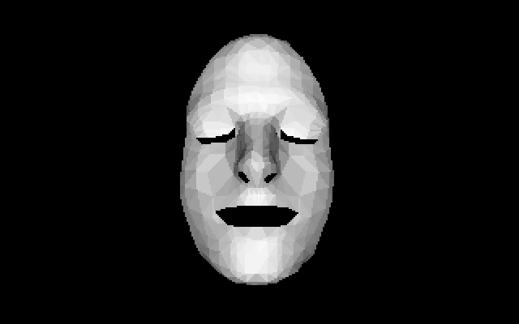
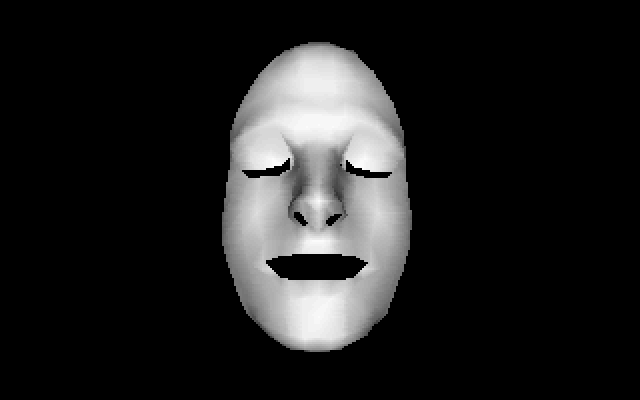
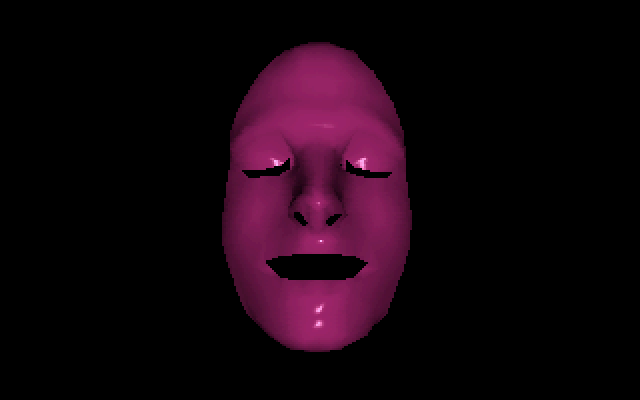
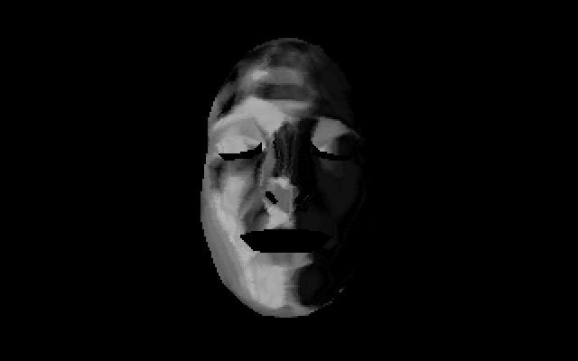
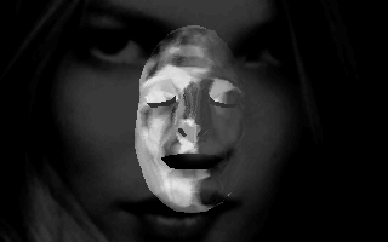
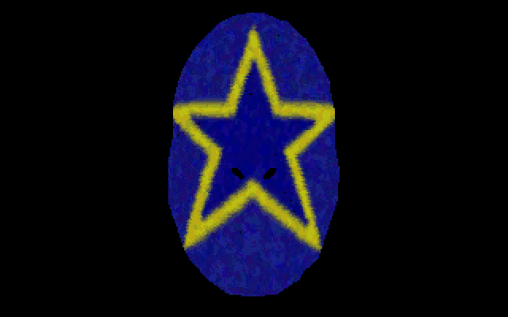
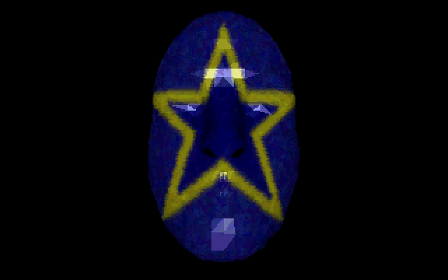
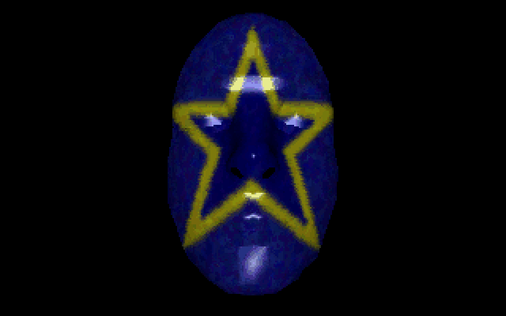
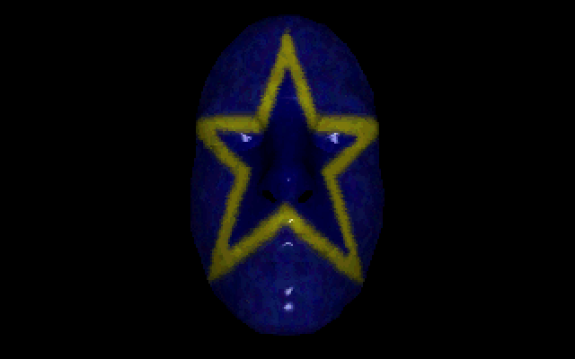
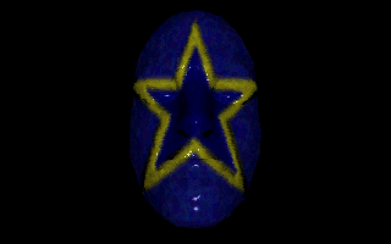
